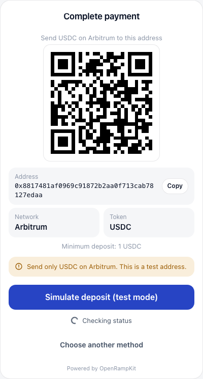

# Relay

`@openrampkit/adapter-relay` moves crypto with [Relay](https://docs.relay.link): pay from a connected wallet, send to a deposit address, the bridge hop after a fiat onramp, and withdrawals to any wallet address.

```ts
import { relay } from '@openrampkit/adapter-relay'

relay({
  apiKey: process.env.RELAY_API_KEY,
  appFee: { bps: 25, recipient: '0xYourFeeAddress' },
  referrer: 'your-app',
  rpcUrls: { 'eip155:8453': process.env.BASE_RPC_URL! }, // for same-chain checks
})
```

To get the keys, see [Get provider keys](../guide/provider-keys.md#relay).

## Options

| Option | Type | Default | Description |
|---|---|---|---|
| `apiKey` | `string` | none | Sent as `x-api-key`. Needed for `GET /requests/v3` (status of deposit-address legs, and the delivered amount of a `wallet` leg) and higher rate limits. |
| `baseUrl` | `string` | `https://api.relay.link` | Use `https://api.testnets.relay.link` for testnets. `adapter.env` is `sandbox` for the testnets host, else `production`. |
| `appFee` | `{ bps: number; recipient: string }` | none | Your fee in basis points. It accrues as a claimable balance at Relay. |
| `referrer` | `string` | none | Relay `referrer`, for attribution |
| `refundTo` | `'origin' \| 'recipient' \| string` | `'origin'` | Where Relay refunds failed deposit-address requests. `'origin'` turns on automatic refund to the original sender. `'recipient'` refunds to the session's destination address (use it only when that address is the user's own wallet on every chain). An address sends all refunds there. |
| `exchangeTransfer` | `boolean` | `false` | Also offer the transfer leg as the `exchange_transfer` method ("From an exchange"). Its refund never goes to the sender by choice, because the sender is the exchange's hot wallet: it goes to an explicit `refundTo` address, then to the connected wallet, then to the recipient (with `'recipient'`). With none of these, the refund goes to the sender and the deposit screen warns the user. |
| `rpcUrls` | `Record<string, string>` | public RPCs for Ethereum, Base, Arbitrum, Optimism, Polygon, Tempo, Solana (mainnet and devnet), Arbitrum Sepolia, Robinhood Chain Testnet | JSON-RPC URL per CAIP-2 chain. The adapter uses it to check same-chain, same-token moves on chain. Set your own in production: the public RPCs have rate limits. |
| `signSettlementIntent` | `(typedData) => Promise<string>` | none | Signs the EIP-712 intent for a settlement contract that has an intent signer. See [On-chain settlement](../concepts/settlement.md). |
| `settlementIntentTtlSec` | `number` | `1800` | How long a signed settlement intent stays valid, in seconds |
| `slippageBps` | `number` | none (Relay picks) | Relay `slippageTolerance` in basis points (0 to 10000), sent with every quote. A `wallet` quote then has this value as `slippageBps`. |
| `amountToleranceBps` | `number` | `50` | How far below the expected amount a deposit can be and still complete a `transfer` leg, in basis points. A `bridge` leg uses at least 500. See [One deposit, one session](#one-deposit-one-session). |
| `logBlockRange` | `number` | `2000` | The most blocks in one `eth_getLogs` call, for same-chain `transfer` checks. Set it to the limit of your RPC. At most `10000`. |
| `rpcRequestsPerSecond` | `number` | no limit | The most JSON-RPC requests per second to one RPC URL, from this adapter instance. Calls wait for their turn. Set it when you use the public RPCs. |
| `gasless` | `boolean` | `true` | Gas abstraction for the `wallet` leg: when the client asks for it, a permit route signs instead of sending. Set `false` to always send `WALLET_TX`. See [Gas abstraction](#gas-abstraction). |

::: warning No API key
Set an API key. Two facts apply:

- Relay requires an API key for quotes (`POST /quote/v2`) under its announced policy from 2 Oct 2026. Some requests without a key may still work today, but Relay can refuse them at any time. Always set `RELAY_API_KEY`. The adapter uses quotes for prices and for deposit addresses. Source: [Relay API keys](https://docs.relay.link/references/api/api-keys). On 9 Oct 2026, some quotes without a key still returned `200`. A quote that sets `referrer` without a key is refused now. When Relay refuses a quote, it returns 401 with `errorCode` `UNAUTHORIZED_QUOTE`. The adapter maps it to `PROVIDER_UNAVAILABLE` (not retryable), with a message that names `RELAY_API_KEY`, and logs a warning.
- Without `apiKey`, status checks for `transfer` and `bridge`, and the delivered amount of a `wallet` leg, use the deprecated `GET /requests/v2`. Relay retires it on 2026-11-24.

When there is no key, the adapter logs a warning once, on its first call.
:::

## Legs

| Leg | Method | From | To | Surface | Notes |
|---|---|---|---|---|---|
| `wallet` | `wallet` | Any crypto in the user's wallet | Any crypto at an address | `WALLET_TX`, `WALLET_SIGN` | Requires a connected wallet (deposits). EVM and Solana source chains. Also the "To wallet" leg of withdrawals. |
| `transfer` | `transfer` | Any crypto in the user's wallet | Any crypto at an address | `DEPOSIT_ADDRESS` | Any amount. The user sends from any wallet or exchange. |
| `bridge` | (hop) | USDC on Base, Arbitrum, Optimism, Polygon or Ethereum, at an address | Any crypto at an address | none shown | The second leg of a two-leg pathway |

All legs allow every region.

### wallet

- The quote calls Relay `POST /quote/v2` with the user's source token and the destination. `EXACT_INPUT` by default; `EXACT_OUTPUT` when the amount is on the destination side.
- Same chain and same token: no Relay. The adapter builds a plain transfer (native value or ERC-20 `transfer`), with no fees. It checks the transfer on chain (see [Same-chain moves](#same-chain-moves)).
- On start, the adapter reuses the quote's transaction steps when they are less than 20 seconds old and built for the same user. Otherwise it quotes again with the user's address.
- The wallet sends Relay's `transaction` steps. A route that needs another `signature` step fails with `PROVIDER_DECLINED` and suggests another token or "Transfer crypto". The one exception is the permit step of [Gas abstraction](#gas-abstraction).
- After the wallet sends, the client fires `submit_tx` with `{ txHash }`. The adapter then checks `GET /intents/status/v3?requestId=...`.
- Transactions: the leg reports a `source` transaction and a `destination` transaction (see `Transaction.role`). The `source` is the origin chain transaction that the wallet sent (`submit_tx`), else the first of Relay's `inTxHashes`. The `destination` is the fill on the destination chain (the first of Relay's `txHashes`) once Relay reports it. When Relay refunds the request, that transaction has the role `refund`. The session shows them in `result.transactions`. For `transfer` and `bridge` legs, the `source` is the transfer into the deposit address (`depositAddress.depositTxHash`, else the first of `data.inTxs`). A same-chain move has one hash with two roles: `source`, and `destination` (or `settlement`) once it is confirmed.
- `providerRef` is the Relay request id, when the leg has one. A same-chain move has no Relay request, so it has no `providerRef`.

#### Gas abstraction

A user with USDC and no native gas (for example no ETH on Base) can pay with the `wallet` method. The wallet signs a message, not a transaction. Relay's solver sends the origin transaction and takes its gas from the input token. This uses Relay's [permit-based gasless flow](https://docs.relay.link/features/gasless-swaps#permit-based-gasless). It needs no relayer of your own, no fee sponsorship and no extra keys.

**When it applies.** All of these must be true:

1. The client asks for it. `select` sends `gasless: true`. The controller does this by `FlowOptions.gasless`:
   - `'auto'` (default): the wallet reports a zero native balance on the chain it pays from.
   - `'always'`: also when the wallet has gas.
   - `'never'`: never.
   The controller also needs a wallet with `signTypedData` (`wagmiWallet`, `privyWallet`), and a UI that renders `WALLET_SIGN`.
2. The adapter option `gasless` is not `false`.
3. The source is an ERC-20 on an EVM chain, and the route goes to another chain. A native token never uses it. A same-chain, same-token payment is a plain transfer without Relay, so the wallet pays gas there.
4. Relay returns a permit route. The adapter quotes again with `usePermit: true`. It does not send `useMulticallAuthorization`, so Relay keeps the single EIP-3009 permit on its v3 ApprovalProxy during the 3.2 transition. It uses the result only when every step is an EIP-712 signature for `POST /execute/permits`. USDC (EIP-3009) gives this route. For other tokens Relay returns transactions, and the wallet sends them as usual.

If one of these is false, the leg shows `WALLET_TX` as before. A user who has gas sees no change.

**Steps.**

1. `start()` returns a `WALLET_SIGN` surface `{ chain, address, signatures }` and the transition `submit_signatures` (SURFACE_RESULT, `expects: 'signatures'`). The `signatures` are the EIP-712 messages, in order: today one EIP-3009 authorization (a `MulticallAuthorization` before it only in the strict shape below).
2. Before it shows the messages, the adapter checks them (`permitProblem` in `permit.ts`). Every check fails closed: if a check fails, or a field cannot be read, the adapter logs a warning and falls back to `WALLET_TX`. Nothing is shown, signed or posted.
   - Each item is a known message type (`ReceiveWithAuthorization`, `TransferWithAuthorization` or `MulticallAuthorization`) with exactly the known `types`, for the origin chain and this Relay request, and is posted with the matching kind. An unknown type (for example an ERC-2612 `Permit`) is refused. An item that Relay marks complete is refused.
   - Exactly one EIP-3009 authorization. It is for the origin token, from the paying wallet, with a value more than zero and at most the quoted input plus 1%. Its nonce is 32 bytes. It is valid now, and for at most 1 hour. Alone, it must pay a Relay v3 ApprovalProxy.
   - At most one `MulticallAuthorization`, before the EIP-3009 item, for a Relay v3.2 ApprovalProxy. It is from the paying wallet, and `refundTo` and `nftRecipient` are the paying wallet. The relayer is Relay's EVM solver. It sends no native value and has empty `metadata`. It has exactly one `funding` entry (index 0): the origin token from the paying wallet, inside the bound, valid now for at most 1 hour. Every call must be an ERC-20 `transfer(to, amount)` of the origin token, decoded in full: exact selector and length, a clean 20-byte address, `to` Relay's solver or RelayReceiver, and an amount above zero. Together the transfers move exactly the funded amount. Any other call is refused, also a call to a Relay router or proxy, and any `approve`: their effect cannot be bounded here. The EIP-3009 item pays that same v3.2 proxy, with the same amount and `validBefore` as the funding entry. In practice Relay's MulticallAuthorization calls its router, so the adapter refuses it and falls back to `WALLET_TX`.
   - One EIP-3009 nonce serves one payment: the adapter claims it (`permitnonce:...`) before it shows the messages. A nonce that another session holds is refused.
3. The wallet signs each message (`signTypedData`). The client fires `submit_signatures` with `{ signatures: string[] }`.
4. The server checks the stored messages again with the current time. An expired permit fails with `409` (`recovery: 'choose_other'`), and nothing goes to Relay. Then it recovers the signer of every signature from the stored message (EIP-712 in `@openrampkit/adapter`, secp256k1 from `@noble/curves`). A missing, extra or malformed signature, or one from another account, fails with `BAD_REQUEST`, and nothing goes to Relay. Then it posts each signature to `POST /execute/permits?signature=...` with Relay's body, in order. It counts the posted items, so a retry after an error posts only the rest.
5. The leg is `processing`. Status follows `GET /intents/status/v3`, as for a transaction payment. Only Relay's fill completes the leg, and the delivered amount is checked against the quote. A permit payment completes only when the adapter can read the delivered amount from Relay's request: until then it stays `processing`. The `source` transaction is the one that Relay's solver sent (`inTxHashes`).

**Fees.** Relay takes the origin gas from the input token, as part of its fee. The `wallet` quote that the user sees comes from the normal route, so the delivered amount can be a little lower (about 0.005 USDC on Base). It stays inside `minOutput`.

**Limits.**

- Same-chain swaps through a permit (Relay's `authorize2`, Permit2) need fee sponsorship, so the adapter does not use them.
- The Relay addresses are fixed in the adapter (`RELAY_APPROVAL_PROXIES_V3`, `RELAY_APPROVAL_PROXIES_V32`, `RELAY_SOLVER`, `RELAY_TOKEN_RECIPIENTS` in `permit.ts`, from Relay's contract table). When Relay moves to a new contract, or ends the single EIP-3009 permit on the v3 proxy, gas abstraction falls back to `WALLET_TX` until the adapter knows the new shape.
- The permit is valid for 10 minutes (Relay's `permitExpiry` default). After that, `submit_signatures` fails and the user chooses again.
- An embedded wallet that you control can also use Relay's EIP-7702 or ERC-4337 flows. These need an app balance at Relay (fee sponsorship), so they are not built in.

#### Solana and Tempo

- **Solana origin.** Relay returns Solana instructions and address lookup tables. The adapter puts them in the `WALLET_TX` surface as a `SolanaTxRequest` (`type: 'instructions'`). `@openrampkit/solana` builds, signs and sends the transaction. `submit_tx` takes the base58 signature.
- **Solana `user`.** Relay needs a `user` of the origin chain's kind. The quote uses a placeholder until a Solana address is known. The payment starts only with a Solana address; else it fails with "Connect a Solana wallet to pay from Solana."
- **Solana destination.** Deposits from EVM chains to Solana work with a Solana `recipient`. For open deposit addresses on an EVM origin, `user` is an EVM placeholder, because Relay rejects a Solana `user` there.
- **Solana deposit addresses.** An open deposit address on Solana (the user sends from Solana) needs a Relay API key.
- **Tempo.** Relay supports Tempo (chain id `4217`). USDC on Tempo is `0x20c000000000000000000000b9537d11c60e8b50`. See [Chains and tokens](../concepts/chains.md#tempo).

See [Solana](../guide/solana.md) for the full guide.

#### Withdrawals

In a [withdraw session](../guide/withdraw.md), the `wallet` leg sends the session's source token to the address the user picked, on any chain and token that Relay supports. The sender is the connected wallet (`custody: 'user_wallet'`), or `treasury.address` (`custody: 'app'`). Set `treasury.address` for app custody: Relay builds its transactions for the sender, and without it the quote uses a placeholder sender. The treasury hook gets every transaction step in order (for example an approval, then the deposit).

### transfer

- The quote asks Relay for an **open deposit address** (`useDepositAddress: true`) for the source token and the destination. Relay gives a new address for each quote. The adapter keeps one address per session and route (in the session store, for 24 hours). It never gives the address of one session to another session.
- When the user did not enter an amount, the quote uses a nominal amount (10 units of a 6 to 8 decimal token, else 0.005) to show the rate.
- The leg ref is `dep:<sessionId>:<address>`, so one ref maps to one session.
- Status reads the Relay requests of the deposit address (`depositAddress=...`), oldest first. It binds the first request that was created after the leg started (with one minute of slack) and that no other session has. Relay can re-quote a deposit under a new request id, so the bind key is the deposit tx hash (`depositAddress.depositTxHash`). Then status follows that request only (by `id` when it is no longer in the list).
- When the user entered an amount, the request deposit (`metadata.currencyIn.amount`) must be at least that amount minus `amountToleranceBps`. A smaller deposit does not complete the leg. Relay still delivers or refunds it.
- Same chain and same token: the address is the destination itself. See [Same-chain moves](#same-chain-moves).



### bridge

- Before the first leg is quoted, the server calls `prepareDeposit()`. The adapter returns an open deposit address from the hop asset to the destination. The first leg (for example Swapped) delivers there.
- The bridge leg starts as `processing` with the detail code `waiting_for_deposit`, and completes when Relay reports the request as `success`.
- The expected deposit is the input of the bridge quote. The tolerance is at least 5%, because the onramp can deliver a little less than its quote.

### Standing deposit addresses

`standingAddress()` gives one Relay open deposit address per user and route, with the destination address as the recipient. The adapter keeps it in the shared store for 400 days after the last call. `standingDeposits()` reads the Relay requests of that address (`depositAddress=...`, up to 5 pages of 20). It looks back 24 hours before `since`, because Relay can show a deposit transaction some time after it made the request. The server drops deposits it already has. A request with no deposit transaction yet is left out until Relay shows one, so every deposit id is a deposit transaction. Relay can give a session's transfer leg the same address as a standing address. Both flows claim a deposit with the same key, so one deposit goes to one of them only, the first that claims it. A deposit's `legRef` is `sreq:<requestId>|<address>|<depositKey>`. Relay can re-quote a deposit under a new request id, so `status()` takes the newest request at the address for the same deposit transaction, and reads the request by id when it is not there. The refund address follows `refundTo`: for user wallets set `refundTo: 'recipient'`. See [Standing deposit addresses](../guide/deposit-addresses.md). Relay gives standing addresses only for a route that converts (another token or chain). For the destination token on the destination chain, add the [chain-watch adapter](./chain-watch.md).

## Source tokens

`sourceTokens()` gives the deposit picker Relay's default list of verified tokens for each chain (`POST /currencies/v2` with `defaultList` and `verified`). For `transfer` and `exchange_transfer` it asks only for tokens that Relay accepts on a deposit address (`depositAddressOnly`). Each chain's list is cached for 6 hours. A chain that fails is left out, and the server still shows USDC and the native token there.

## Quotes and fees

| Quote | Guarantee | Notes |
|---|---|---|
| `wallet` through Relay | `min_output` | `LegQuote.minOutput` is Relay's `minimumAmount`: the smallest output after slippage. `slippageBps` is set when you set the `slippageBps` option. When Relay sends no `minimumAmount`, the quote is an `estimate`. |
| `transfer` and `bridge` (deposit address) | `estimate` | An open deposit address takes any amount, and Relay prices each deposit when it arrives. So `minimumAmount` does not bind the deposit. |
| Same chain and same token (`wallet` or `transfer`) | `firm` | A plain transfer: the recipient gets exactly the amount. No fees. |

- Every quote has an `expiresAt` from `quoteExpiresAt()`. A `wallet` quote through Relay expires after 1 minute, because its transaction steps go stale. The other quotes expire after 5 minutes.
- Fees, each in its own token: the origin chain gas is a `network` fee with `included: false` (the wallet pays it on top of `input`). The Relay fee (`provider`) and your `appFee` (`app`) have `included: true`: Relay takes them from the amount that it routes.
- The server checks the delivered output against `minOutput` when the quote has one. Else it uses `policy.outputToleranceBps`.

## Same-chain moves

When the source and the destination are the same token on the same chain, Relay is not involved. The adapter checks the chain itself with the shared chain watcher of `@openrampkit/adapter` (`createChainWatch`), with JSON-RPC calls to `rpcUrls[chain]` (or the default public RPC). A chain without an RPC URL cannot use same-chain moves: the RPC step (the `transfer` start, or the `wallet` status check) fails with `PROVIDER_UNAVAILABLE` ("No RPC is configured to verify transfers on ...").

| Leg | Check |
|---|---|
| `wallet` | After `submit_tx`, the leg is `processing` (detail code `confirming`) until the receipt exists (`eth_getTransactionReceipt`). The leg succeeds only when the transaction succeeded, was mined after the payment started (the block time from `eth_getBlockByNumber`, with 5 minutes of clock tolerance), paid the recipient at least the quoted amount (the value of a native transfer from `eth_getTransactionByHash`, or the sum of the token's `Transfer` logs to the recipient), and did not complete another payment before. Otherwise it fails with `DELIVERY_FAILED`. |
| `wallet` with `destination.settlement` | The wallet sends `approve` and `settle` to the settlement contract. The adapter reads the contract receipt of the session (`eth_call`) and its `Settled` log (`eth_getLogs`). The leg succeeds when the token, the recipient, the amount and the calls agree with the quote. It does not need the transaction hash. See [On-chain settlement](../concepts/settlement.md). |
| `transfer` | At start, the adapter records the current block (`eth_blockNumber`). Status reads the token's `Transfer` logs to the destination since that block (`eth_getLogs`), in pages of `logBlockRange` blocks, at most 5 pages per check. The next check goes on from where the last one stopped. One log completes the leg, with its amount as the output. The adapter does not add logs together. See [One deposit, one session](#one-deposit-one-session). Native tokens are not detected: the leg stays in `PAYMENT`. |
| `wallet` (Solana) | `getSignatureStatuses` must show `confirmed` or `finalized` with no error. Then `getTransaction` (`jsonParsed`) must show that the recipient got at least the quoted amount: the balance change of its token accounts for the mint, or its lamport change for SOL. The block time must not be before the payment started (5 minutes of tolerance). One signature completes one payment only. |
| `transfer` (Solana) | Status reads the recipient's token accounts for the mint (`getTokenAccountsByOwner`), then their recent signatures (`getSignaturesForAddress`) since the leg started. It reads the new, successful signatures oldest first. One signature completes the leg, with what it paid the recipient as the output. The adapter does not add signatures together. The rules are the same as for `Transfer` logs on EVM: see [One deposit, one session](#one-deposit-one-session). For SOL, it reads the signatures of the recipient address. |

::: warning What the check does not cover
The `wallet` check proves that a new transaction paid the recipient, and that no other session of this adapter used the same hash (the record lives in the shared store for 90 days). It does not check who sent it. The `transfer` check takes a transfer to the destination after the start block, from any sender. Store the hashes of `result.transactions` with a unique constraint when you credit. See [Credit exactly once](../guide/webhooks.md#credit-exactly-once).
:::

## One deposit, one session

A deposit completes one session only. These rules apply to same-chain `transfer` legs (EVM `Transfer` logs and Solana signatures) and to deposit-address legs (`transfer` and `bridge`).

1. **Amount.** When the user gave an amount, one deposit must be at least that amount minus `amountToleranceBps` (default 0.5%; a `bridge` leg uses at least 5%). The adapter uses integer math in base units. A dust transfer does not complete a leg. When the user gave no amount, any deposit above zero counts.
2. **Used record.** The adapter records each deposit as used in the shared store for 90 days: a `Transfer` log by (chain, tx hash, log index), a Solana deposit by (chain, signature), and a Relay request by its deposit tx hash. A used deposit never completes a second session. A same-chain `wallet` payment cannot use a transaction that a `transfer` leg used, and the reverse.
3. **Ambiguity.** Each open deposit leg puts a watch on its address in the shared store (for 24 hours). When another open leg on the same address could also claim a deposit, the deposit is ambiguous. An exception: the deposit is the exact amount of this leg (within the tolerance) and of no other leg. An ambiguous deposit completes no session. The leg stays in its waiting state with the detail code `ambiguous_deposit`, and the adapter logs a warning. A finished leg removes its watch.

The adapter writes the used record with `claimOnce`. On a store with `putIfAbsent` (`memoryStore`, `redisStore`, `durableObjectStore`), the claim is atomic: when two status checks take the same deposit at the same moment, exactly one wins. On a store without it (for example Workers KV), the adapter writes the used record, then reads it back. Two checks at the same moment can then still race.

::: tip Safe setups
A shared destination (one treasury or vault address for all users) cannot tell two sessions with the same amount apart. Use one of these:

- **A unique address per session.** Relay deposit-address legs do this: each session gets its own Relay address. For same-chain deposits, give each session its own destination address.
- **A wallet payment.** The `wallet` leg checks the tx hash that the user's wallet sent for this session.
- **A settlement contract.** With `destination.settlement`, the contract records the session id. See [On-chain settlement](../concepts/settlement.md).
:::

## Status mapping

| Relay status | Leg |
|---|---|
| `success` | `succeeded` (`COMPLETED`) |
| `failure` | `failed` with `DELIVERY_FAILED` |
| `refund` | `refunded` (`REFUNDED`) |
| `waiting` | `processing`, detail code `waiting_for_deposit` |
| `depositing` | `processing`, detail code `confirming` |
| `pending` | `processing`, detail code `bridging` |
| `submitted` | `processing`, detail code `confirming` |
| `delayed` | `processing`, detail code `delayed` |
| other | no change: the adapter logs the unknown status once, and the leg keeps its last step |

The adapter maps the statuses with `statusMap` from `@openrampkit/adapter`. An unknown status never becomes `processing` by accident. The raw Relay status goes to `detail.providerStatus`. The session timeline keeps each new value.

The output of a completed leg:

- `wallet`: the intent status has no amount. When it is `success`, the adapter reads the request (`GET /requests/v3?id=<requestId>`). The leg's `output` is `data.route.actual.destination.outputCurrency`, else `data.metadata.currencyOut`. The adapter never uses the quoted route as the output. The server compares the output with the quote, and `result.outputConfirmed` is `true`. When the lookup fails, the leg completes without an output, and `outputConfirmed` stays `false`.
- `transfer` and `bridge`: the request output (`data.route.actual`, else `data.route.quoted`, else `data.metadata.currencyOut`).
- When the output is the same asset as the quote, it has the quote's asset. For example, Relay names native ETH `0x0000000000000000000000000000000000000000` and the quote names it `native`. An output in another asset keeps Relay's asset, so the server sets `result.delivery` with the status `asset_mismatch`.

## Webhooks

The Relay adapter has no webhook handler. Status comes from polling: the browser's step poll, and the [background sweep](../api/server.md#background-sweep) (or `openramp.sessions.refresh(id)`) after the user leaves.

## Sandbox limits

The testnets host (`https://api.testnets.relay.link`) knows ETH on Base Sepolia and on Sepolia. It does not know USDC on Base Sepolia. To test on testnets, quote ETH, not USDC. Checked on 9 Oct 2026. See [Get provider keys](../guide/provider-keys.md#sandbox-and-production).

## Verified vs TO VERIFY

The source has no TO VERIFY markers for Relay. The Relay API paths used are `/quote/v2`, `/currencies/v2`, `/intents/status/v3`, `/requests/v3` (with a key) or `/requests/v2` (by `depositAddress`, or by `id`), and `/chains` (health). A live check on 2026-10-05 showed: two `/quote/v2` calls with `useDepositAddress: true` and the same parameters give two different addresses; a request has `depositAddress.depositTxHash` and `metadata.currencyIn.amount` (base units); `inTxs[].data.value` is `0` for an ERC-20 deposit. Same-chain checks use the JSON-RPC methods `eth_getTransactionReceipt`, `eth_getTransactionByHash`, `eth_getBlockByNumber`, `eth_blockNumber`, `eth_getLogs` and `eth_call` (settlement receipts) on EVM chains, and `getSignatureStatuses`, `getTransaction`, `getTokenAccountsByOwner` and `getSignaturesForAddress` on Solana.
